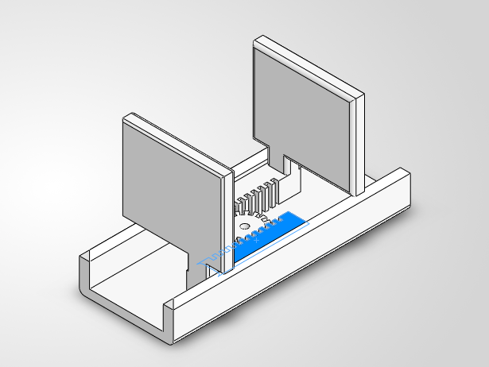

# Industrial 2-Finger Parallel Gripper

A rack-and-pinion parallel-jaw gripper designed in SolidWorks for a 5–10 kg payload.
Mini project from the **Industrial Training Program on Robotics and AI (My Equation)**.

> **Status: v1.** CAD, assembly and load calculations are complete. The ANSYS stress simulation has **not** been run yet, and a few known issues are listed below. This repository will be updated as v2 progresses.

## Demo



Motion demo: [▶ Simulation of gripper.mp4](https://drive.google.com/file/d/12m1tMRSESHUtKnj7kM2mlYHdZjlzIR5c/view?usp=drive_link)

## How it works

A single central pinion meshes with two racks on opposite sides of it. Each rack is attached to one finger. When the pinion turns, the two racks move in opposite directions by the same distance, so both jaws open and close symmetrically. The walls of a U-shaped housing channel keep the fingers sliding in a straight line.

Rack travel per pinion revolution = π × m × z = π × 1.25 × 16 ≈ **62.8 mm per finger**.

## Design summary

| Item | Value |
|---|---|
| Mechanism | Rack and pinion, one central pinion, two racks |
| Payload | 5–10 kg |
| Module | 1.25 mm |
| Pinion | 16 teeth, 20 mm pitch diameter, 22.5 mm outside diameter, 8 mm thick, 4 mm bore |
| Rack | 3.927 mm pitch, 10 notches (2.6 mm wide, 2.8 mm deep) |
| Housing | 140 × 76 mm base block with a 100 × 60 mm pocket, cut into a U-shaped channel |
| Finger | 60 × 50 mm plate with neck, fillet and chamfer, rack bar 60 mm long |
| Software | SolidWorks Design Premium 2026 SP0.0 |
| Colours | Housing and pinion yellow, fingers blue |

The model is parametric: extrude, cut, fillet, chamfer, linear pattern (rack teeth) and circular pattern (pinion teeth).

## Load calculations (hand-calculated)

Assumptions: friction coefficient μ = 0.3, safety factor 1.5, friction-only grip with two contacts.

`F = SF × m × g / (2 × μ)`

| Payload | Force per finger | Pinion torque (T = 2·F·r, r = 10 mm) |
|---|---|---|
| 5 kg | ≈ 123 N | ≈ 2.5 N·m |
| 10 kg | ≈ 245 N | ≈ 4.9 N·m |

A small N20 gear motor can't deliver this torque. A higher-torque geared motor or servo is needed. Rubber finger pads (μ ≈ 0.6) would roughly halve the required force.

Quick hand checks (not a replacement for FEA):
- Finger plate as a cantilever ≈ 19 MPa (lever arm estimated).
- Pinion tooth (Lewis) ≈ 85 MPa, so the pinion should be steel.

Full details are in [`report.pdf`](report.pdf).

## Known issues in v1

- **No FEA yet.** There are no verified stress or deformation results. The values above are hand estimates.
- **Second finger not rotated 180°** in the assembly, so the rack mesh on that side is not set up correctly.
- **Rectangular teeth** instead of involute profiles, causing small tooth-tip interferences (8 overlaps, ≈ 115.8 mm³ in total, see `simulation_results/interference results.xlsx`). These need to be re-checked after the assembly is fixed.
- **Materials:** the finger is set to 6061-T4 in the model, the pinion has no material assigned yet.
- **No STEP export** yet.

## Roadmap (v2)

- [ ] Fix the second finger's orientation and re-check the mates
- [ ] Involute tooth profiles to remove the interference
- [ ] ANSYS static structural analysis (stress, strain, deformation, factor of safety)
- [ ] Assign materials consistently (steel pinion)
- [ ] Rubber finger pads
- [ ] Actuator selection for about 5 N·m
- [ ] STEP export of the assembly

## Repository structure

```
Industrial_Gripper_Design/
├── README.md
├── report.pdf              Project report
├── cad_files/              SolidWorks parts and assembly (.SLDPRT, .SLDASM)
└── simulation_results/     Screenshots, interference results, demo video
```

## How to open

Open `Assemble_parallel_gripper.SLDASM` in SolidWorks (the parts must be in the same folder). Once a STEP file is added, the model can also be opened in other CAD software.

## Author

**Vedant Deshmukh**

Feedback on gear design or FEA setup is welcome. Please open an issue or message me.
